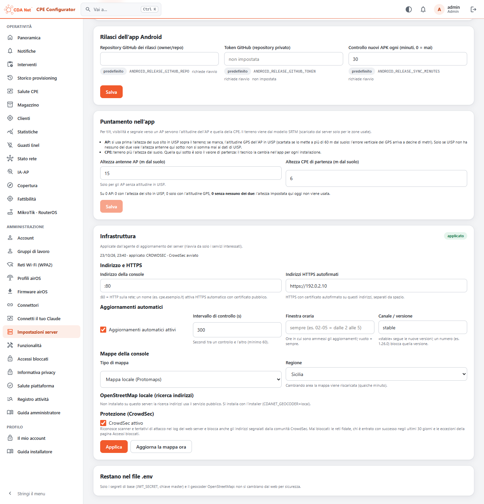
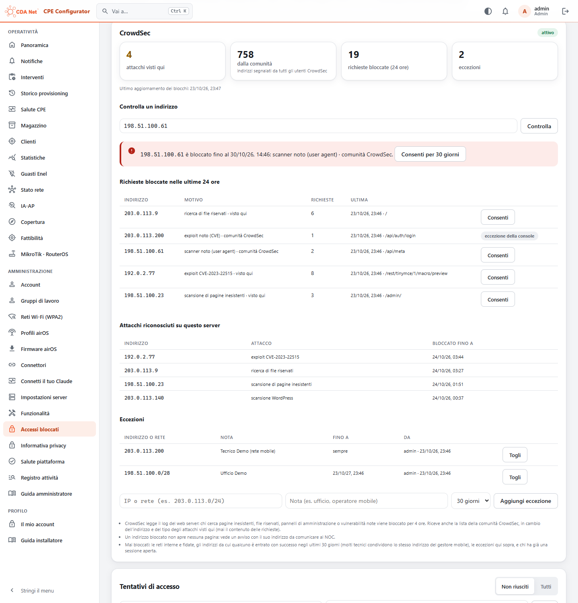

# Accessi bloccati (come fail2ban) e CrowdSec

La piattaforma registra ogni tentativo di accesso: dalla console web, dall'app e dal connettore Claude. Ogni tentativo vale, sia con la password, sia con il codice della verifica in due passaggi, sia con l'accesso rapido del telefono, sia con il consenso di Claude. Dopo **5 tentativi falliti in 15 minuti** blocca l'IP e il dispositivo da cui arrivano.

## Regole

- Il blocco dura **30 minuti**. Se lo stesso IP o dispositivo viene bloccato di nuovo entro 24 ore, dura **24 ore**.
- **Blocco per IP.** Vale solo per gli accessi e per le richieste senza una sessione valida. Chi è già collegato dallo stesso IP continua a lavorare. Serve perché molti installatori escono su Internet con lo stesso IP del gestore mobile (CGNAT): uno che sbaglia la password non deve fermare i colleghi.
- **Blocco per dispositivo.** Blocca tutto da quel dispositivo, anche con una sessione aperta. L'app manda un proprio identificativo, `X-CDA-Device`: un UUID casuale creato all'installazione, che non è un dato del telefono. **Lo sceglie il dispositivo**, quindi chi attacca può cambiarlo a ogni tentativo. Ferma un'app o un PC che sbagliano in continuazione, non un attaccante: contro la forza bruta conta il blocco per IP.
- **Mai bloccati per IP:**
  - il server stesso (loopback);
  - le reti private: i container, le LAN interne e la rete del gestore (CGNAT 100.64.0.0/10);
  - gli indirizzi in `LOGIN_BAN_IGNORE` del file `.env`, separati da spazio o virgola, IP o CIDR, per esempio l'ufficio.

  Per loro resta il limite di 10 tentativi per utente in 10 minuti.
- L'IP considerato è quello vero del client. `X-Forwarded-For` vale solo se arriva dal proxy della piattaforma (Caddy, `TRUST_PROXY`), e Caddy sovrascrive quello che manda un client esterno.
- Durante il blocco, la risposta è `429 {"error":"banned","until":"…"}` con `Retry-After`.
- Ogni blocco manda un avviso di sicurezza al NOC (Telegram) e finisce nel Registro: `auth.ban`, `auth.unban`.
- Il registro dei tentativi si tiene 90 giorni. Contiene ora, IP, dispositivo, utente tentato, canale (web, app, claude), tipo ed esito, **mai la password**.

## Console

Amministrazione → **Accessi bloccati**: i blocchi in corso (o tutti) con il bloccato, dal, fino a, motivo, utenti tentati e ultimo tentativo, e il pulsante per sbloccare; sotto, il registro dei tentativi di accesso con i filtri. API:

- `GET /api/admin/bans`: blocchi in corso e passati, con `lastAttemptAt`, gli utenti tentati e i flag `active` / `expired`.
- `DELETE /api/admin/bans/:id`: sblocca subito.
- `GET /api/admin/login-attempts?failed=1&ip=&username=&limit=`: il registro dei tentativi.

## CrowdSec (v1.36.17)

Il blocco qui sopra ferma chi sbaglia la password. **CrowdSec** (titolare, 23/10/2026) protegge il resto del server web: riconosce chi lo scansiona o lo attacca e riceve dalla comunità CrowdSec gli indirizzi già segnalati altrove. È **acceso di serie** (titolare, 24/10/2026): sulle nuove installazioni e, dalla v1.36.18, sui server già installati, al primo avvio dell'agente di aggiornamento. Si spegne da Impostazioni server → **Infrastruttura** → *Protezione (CrowdSec)*, oppure con l'installer (`CDANET_CROWDSEC=0`, o rispondendo no alla domanda della prima installazione).

**Come funziona**

1. Caddy scrive il log degli accessi (JSON, 3 file da 10 MB, 7 giorni) in un volume che legge solo CrowdSec. Gli header `Authorization` e `Cookie` non vengono mai scritti; gli header segreti dell'app (`X-Cda-Bridge-Token`, `X-Backup-Password`) vengono tolti.
2. Il container **crowdsec** (`crowdsecurity/crowdsec:v1.8.1`, circa 170 MB, profilo `crowdsec` del compose, solo sulla rete interna) legge il log con le regole HTTP generiche e le CVE note: pagine inesistenti a raffica, file riservati (`.env`, `.git`), pannelli di amministrazione, WordPress, path traversal, SQL injection, XSS, backdoor, scanner noti dallo user agent. Chi viene riconosciuto è bloccato per 4 ore. È spenta solo la regola del *crawler*: la console apre molte API e tasselli di mappa diversi e verrebbe scambiata per un crawler. Le reti private non vengono mai segnalate.
3. In cambio degli attacchi visti qui (indirizzo, tipo di attacco e ora, **mai il contenuto delle richieste**), CrowdSec riceve la **lista della comunità**: gli indirizzi segnalati da tutti gli utenti CrowdSec.
4. **L'app è il bouncer**: ogni 10 secondi legge le decisioni dall'API locale di CrowdSec con la sua chiave (`CROWDSEC_API_KEY`, generata all'attivazione; l'app la legge da `/data/infra/crowdsec.key`, che c'è solo mentre CrowdSec è attivo). Un indirizzo bloccato riceve `403` su tutto: la console mostra una pagina con il suo indirizzo da comunicare al NOC, le API rispondono `{"error":"blocked_ip"}`.

**Mai bloccati** (molti installatori escono con lo stesso IP del gestore mobile, e la lista della comunità può contenerne uno):

- le reti mai bloccate per IP qui sopra: il server, le reti private, `LOGIN_BAN_IGNORE`;
- gli indirizzi da cui qualcuno è **entrato con successo negli ultimi 30 giorni**;
- le **eccezioni** scelte in console: un IP o una rete, per 7 giorni, 30 giorni, un anno o sempre;
- le richieste con una **sessione valida**: chi è già collegato continua a lavorare anche da un indirizzo segnalato.

**Console**: Amministrazione → **Accessi bloccati** → scheda **CrowdSec**:

- stato (attivo, non raggiungibile, non attivo), attacchi visti qui, indirizzi della comunità, richieste bloccate nelle ultime 24 ore, eccezioni;
- **Controlla un indirizzo**: dice se l'IP di un tecnico che non riesce a entrare è bloccato, perché e fino a quando, e lo consente per 30 giorni con un clic;
- le richieste bloccate nelle ultime 24 ore, con **Consenti**;
- gli attacchi riconosciuti su questo server e fino a quando restano bloccati;
- le eccezioni, con chi le ha messe, e il modulo per aggiungerne. Aggiungere o togliere un'eccezione finisce nel Registro: `security.crowdsec_allow`, `security.crowdsec_allow_remove`.

API (solo admin):

- `GET /api/admin/crowdsec`: stato, conteggi, attacchi visti qui, richieste bloccate nelle 24 ore, eccezioni;
- `GET /api/admin/crowdsec/check?ip=`: se l'indirizzo è bloccato, da quale decisione o perché no;
- `POST /api/admin/crowdsec/allow` `{"value":"203.0.113.0/24","note":"…","days":30}` (senza `days`: sempre);
- `DELETE /api/admin/crowdsec/allow/:id`.

Dal server: `sudo cdanet-cpe crowdsec` (metriche: log letti, attacchi riconosciuti, decisioni, bouncer), `sudo cdanet-cpe crowdsec decisions`, `alerts`, `logs`, `cscli …` (per esempio `sudo cdanet-cpe crowdsec cscli decisions delete --ip 203.0.113.9`).

Spegnendo CrowdSec dalla console, il container viene tolto (i suoi dati restano per quando torna) e l'app smette subito di bloccare. Il blocco avviene nell'app, non nel firewall: vale per la console e per le API, che sono tutto ciò che il server espone a Internet.
