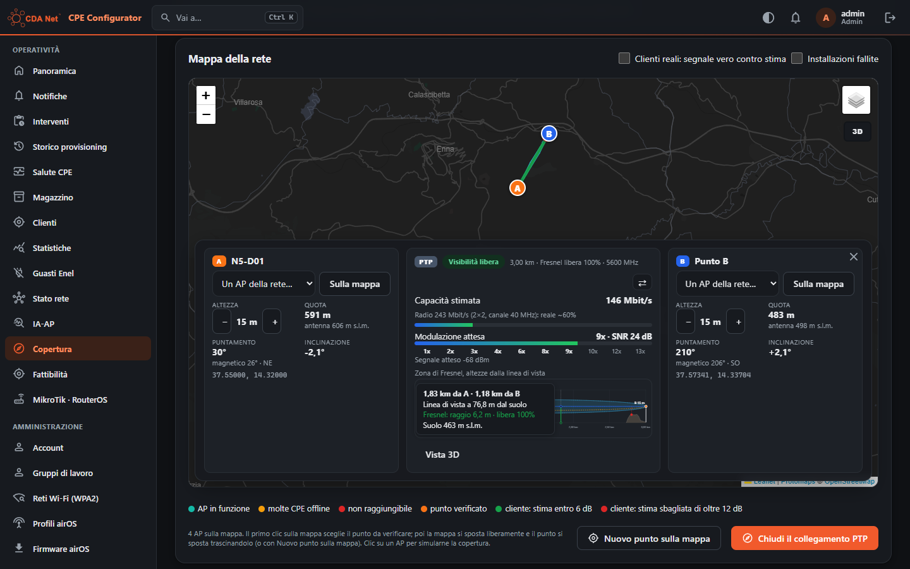

# Copertura (modulo `coverage`)

Prima di un sopralluogo: un indirizzo è coperto, da quale AP, con che segnale e che velocità? La verifica c'è nella console (**Copertura**) e nell'app (area **Copertura** nella barra in basso e scorciatoia in Oggi). Gli stessi calcoli servono all'installazione (AP consigliati), a Trova l'AP e alla realtà aumentata (vedi [FIELD-TOOLS.md](FIELD-TOOLS.md)).

Il modulo si attiva da **Funzionalità**, anche solo per alcuni account (vedi [MODULI.md](MODULI.md)).

## Verifica di un punto

Il punto si sceglie con un indirizzo (geocoder del server, con i civici ANNCSU), con le coordinate, con il GPS o toccando la mappa. Gli amministratori possono anche cercare un AP per nome. Il punto resta fisso e si trascina; «Nuovo punto sulla mappa» ne mette un altro.

Per ogni AP in raggio la verifica dà:
- **segnale atteso** (con forbice e affidabilità della stima) e **modulazione attesa**, ricavata dall'SNR (segnale meno rumore dell'AP) sulla scala airMAX;
- **capacità stimata** del nuovo collegamento, dalla curva segnale → capacità delle CPE reali, e **velocità la sera**: la capacità per il tempo radio che l'AP ha libero al picco serale. Un AP carico non è mai consigliato come buono;
- **CPE da installare**: consigliata per ogni AP (la più piccola che arriva a un segnale buono a quella distanza) oppure scelta tra i modelli Ubiquiti, da NanoStation Loco (13 dBi) a PowerBeam 620 (29 dBi). La stima segue il guadagno dell'antenna;
- **altezza della CPE** dal suolo: cambia il terreno verso ogni AP e la verifica si ricalcola;
- in cima, l'**esito**: probabile, da verificare o improbabile.

Tutti gli AP in raggio vengono valutati prima di applicare il limite: un AP buono un po' più lontano non è nascosto da AP più vicini con un segnale peggiore.

### Collegamento

Toccando un AP si apre il **Collegamento**, come in UISP Design:
- distanza, puntamento vero e magnetico, inclinazione dai due lati, altezze delle antenne;
- **Fresnel libera** e segnale atteso sulla scala delle modulazioni;
- **profilo** del terreno con edifici (grigio), alberi (verde), linea di vista e prima zona di Fresnel; la vista «Zona di Fresnel» mostra le altezze rispetto alla linea di vista;
- con la linea ostruita, il rialzo che serve o «meglio un altro AP».

Il collegamento e la zona di Fresnel (rossa dove invasa) sono disegnati anche sulla mappa. Gli amministratori hanno la **vista 3D** (vedi [MAPPE.md](MAPPE.md)).

### Cosa vede chi

| | Amministratori e direttore tecnico | Installatori e Specialist senza visibilità piena |
|---|---|---|
| AP considerati | tutti | solo i POP e gli AP assegnati (Account → «POP/AP assegnati agli installatori») |
| Raggio | scelto nella verifica: console 30, 50 o 100 km; app da 10 a 100 km. Predefinito: il raggio della Copertura del connettore UISP. Oltre 20 km l'AP compare come «troppo lontano», mai proposto | il raggio del connettore, al massimo 20 km |
| Quanti AP | fino a 50 | quelli di Impostazioni server → «AP mostrati per ogni verifica di copertura» (5) |
| AP deboli | tutti | nascosti sotto «Nascondi gli AP con segnale stimato più debole di» (−70 dBm) |
| Posizione dell'AP | esatta, con la linea verso l'AP | area approssimativa e sola direzione di puntamento, distanze arrotondate |
| Dati dell'AP | clienti, carico serale, rumore, altezza dell'antenna | solo il giudizio sul carico; numero di clienti solo se l'amministratore lo consente |

## Come si stima il segnale

Il modello unisce la teoria radio, il terreno e i clienti reali:
1. **Radio**: EIRP degli AP e guadagno della CPE di riferimento (Impostazioni server → Simulazione radio), spazio libero, perdite reali; con antenna e azimut indicati in **Antenne degli AP**, il diagramma vero dell'antenna (Ubiquiti e RF elements).
2. **Terreno e ostacoli**: modello TINITALY a 10 m (SRTM a 30 m dove manca); edifici dalle sagome di OpenStreetMap e alberi con la loro altezza (Meta/WRI) dove importati, altrimenti la mappa ESA WorldCover con le altezze medie di Impostazioni server. I dati si scaricano per l'area della rete dalla console (Copertura → Terreno e ostacoli). Le antenne stanno sopra i tetti e gli alberi intorno, la CPE sul tetto dell'edificio.
3. **Ostacoli sulla linea**: con la zona di Fresnel disturbata la perdita è la penalità empirica di UISP Design, √(1,5·d/100) − 0,5 dB con d in metri: circa 6 dB a 3 km e 12 dB a 10 km. Sui clienti collegati e dati per ostruiti ha portato l'errore mediano da 40 a 12 dB rispetto alla diffrazione a lama. L'avviso «ostruito» e la valutazione prudente restano.
4. **Calibrazione**: la rete e ogni AP si correggono sui clienti collegati, al netto del terreno del loro percorso. Le installazioni fallite per motivi radio contano come casi negativi. Un AP senza clienti ha una stima teorica (±8 dB). Clienti con posizione sull'AP o oltre 20 km sono esclusi.

**Affidabilità della stima** (console, amministratori): ogni cliente stimato senza di lui, scarto medio, AP e clienti stimati peggio, clienti collegati ma dati per ostruiti con cosa copre la linea e di quanto alzare la CPE.

## Simulazione di un AP (amministratori)

«Simula copertura» su un AP disegna sulla mappa il segnale atteso per una CPE nuova, a celle di 120–250 m: segnale, capacità o velocità la sera. La forma è quella reale: vuota sotto il minimo − 5 dB e dietro le colline, tenue dove la stima è poco affidabile. Se l'AP non ha antenna e azimut la simulazione lo dice (per questo può sembrare un cerchio). C'è anche in 3D.

## Simulazione A → B

Un collegamento tra due punti qualsiasi: un nuovo AP, un ponte radio, una CPE lontana dagli AP esistenti. Il server la consente ad amministratori e Specialist. Nell'app è la scheda «Simulazione A → B» sotto la mappa della verifica di copertura, per amministratori e Specialist: dalla v1.36.15 ha lo stesso schema del collegamento AP–cliente, cioè **A** (arancione, come la CPE), il **collegamento** e **B** (blu, come l'AP), uno sotto l'altro. A e B hanno l'altezza con − e + (la simulazione si rifà da sola), l'antenna, il puntamento vero e magnetico e l'inclinazione; al centro ci sono esito, distanza, Fresnel libera, segnale, capacità stimata nel canale scelto, perdite e modulazione. «A ⇄ B» scambia i due punti. Il profilo si tocca o si trascina con il dito.

Nella console (Copertura completa, amministratori e direttore tecnico) è il **collegamento PTP**, dalla v1.36.14: il pulsante «Collegamento PTP (A → B)» sotto la mappa apre sopra la mappa lo stesso pannello del collegamento AP–cliente.
- **A** a sinistra e **B** a destra: un AP della rete, «Sulla mappa» (dopo A la mappa chiede B), il punto verificato per A; altezza con − e +, quota, puntamento (anche magnetico) e inclinazione.
- **Al centro**: esito, distanza, Fresnel libera, capacità stimata (modulazione attesa su airMAX ac 2×2 nel canale scelto, circa il 60% della velocità radio), modulazione, zona di Fresnel e Vista 3D. «⇄» scambia A e B.
- **Sulla mappa**: A (arancione, come la CPE) e B (blu, come l'AP) si trascinano; il collegamento ha la sua zona di Fresnel colorata dove è libera, invasa od ostruita. Il pulsante 3D della mappa lo mostra con terreno, edifici e alberi.
- **Sotto la mappa**: coordinate, frequenza, canale, EIRP di A, guadagno di B, «Antenne sopra tetti e alberi», i dati e il profilo completo. Ogni cambio rifà la simulazione da sola.

I **profili** (questo e quello AP–cliente) sono interattivi: passando il mouse, o il dito, dicono a che distanza da A e da B si è, a quanti metri dal suolo passa la linea di vista, edifici o alberi sotto la linea, il raggio di Fresnel in quel punto e quanto è libero, la quota del suolo.

- **Punti A e B** sulla mappa (un tocco, poi si trascinano), con il GPS (app) o con le coordinate. Mentre si sceglie un punto, il tocco non avvia la verifica di copertura.
- **Parametri**: altezze di A e B (predefinite quelle di Puntamento), frequenza, EIRP di A, guadagno di B, rumore; vuoti valgono quelli delle Impostazioni server. «Antenne sopra tetti e alberi intorno» le monta come un installatore.
- **Risultato**: esito (libera, Fresnel invasa, ostruita) con il rialzo di A che serve o «non basta un palo» oltre 12 m; distanza, puntamento e inclinazione nei due sensi, antenne, perdite, segnale e modulazione attesi, profilo con la zona di Fresnel; il collegamento colorato sulla mappa. Oltre 20 km è «poco realistico».
- **Diffrazione pura**: oltre alla stima di Copertura (empirica) il server calcola la diffrazione degli ostacoli (Deygout più fogliame, al massimo 60 dB). Con la linea ostruita dal terreno, segnale e modulazione mostrati sono quelli fisici e la stima di Copertura resta come dato secondario: una collina sopra la linea dà, per esempio, −135 dBm e nessuna modulazione invece di −85 dBm e 2x. Un avviso dice quando la diffrazione pura è molto sotto la stima («da non progettare così» sotto −80 dBm).

Distanze da 30 m a 100 km. API: `GET /api/coverage/link`.

## Altri operatori

Con il connettore **MyWic** (Connettori, token cifrato) la verifica mostra anche FTTH, FTTC e radio degli altri operatori nel punto, divisi per **bollino AGCOM** (delibere 292/18, 285/25 e 207/26/CONS): F verde (fibra), FR giallo (misto fibra-rame o fibra-radio), FWA blu (VHCN), R rosso. Per ognuno: tecnologia, stato e velocità, l'indirizzo riconosciuto e il meglio attivabile.
- La card si carica da sola a ogni verifica, anche per gli installatori, che però non vedono i nomi degli operatori.
- «Cerca per indirizzo esatto» procede per comune → via → civico → scala.
- Una verifica si riusa per i giorni impostati (Impostazioni server → Copertura altri operatori), dove si trovano anche la soglia FWA per il bollino FR e le tecnologie FWA con bollino blu.
- Agli Specialist senza visibilità piena la verifica non è disponibile: usa l'abbonamento di CDA Net.

## Verifiche salvate

«Salva» tiene la verifica di un punto con un nome (console e app, anche in Fattibilità):
- gli installatori scrivono il nome a mano (il cliente, il lavoro) e non vedono i clienti di ISP Billing;
- gli amministratori possono anche scegliere un cliente di ISP Billing, tra quelli con un indirizzo entro 300 m dal punto e quelli che corrispondono al nome scritto.

Il server rifà la verifica con le stesse opzioni (CPE, altezza, raggio) e i diritti di chi salva, e tiene il risultato di quel momento, insieme agli altri operatori. «Verifiche salvate» elenca le proprie (gli amministratori anche quelle di tutti) con l'esito di allora: «Apri» rifà la verifica e ricorda cosa diceva, «Rinomina» cambia nome o cliente, «Elimina» la toglie.

## Fattibilità (amministratori e direttore tecnico)

Per il commerciale, nella console: un indirizzo o delle coordinate e una sola risposta.
- La nostra copertura, dalla stessa verifica: servizio disponibile, da verificare con un sopralluogo o non coperto, con l'AP migliore e la capacità stimata la sera.
- Il nostro bollino stimato con le stesse regole degli altri, se la velocità è stimabile.
- Gli AP più adatti e gli altri operatori per bollino.

«Scarica PDF» produce la «Verifica di fattibilità», per uso interno; quella salvata riporta in alto il nome e il codice del cliente.

## API

| Metodo | Percorso | Chi |
|---|---|---|
| GET | `/api/coverage` | modulo Copertura (limiti per gli installatori) |
| GET | `/api/pointing/profile`, `/api/pointing/horizon` | profilo del collegamento, orizzonte per la realtà aumentata |
| GET | `/api/coverage/link` | amministratori e Specialist |
| GET | `/api/admin/coverage/simulation` | amministratori |
| GET/POST/PATCH/DELETE | `/api/saved-checks…` (anche il PDF) | modulo Copertura |
| GET | `/api/admin/feasibility`, `/api/admin/feasibility.pdf` | amministratori e direttore tecnico |
