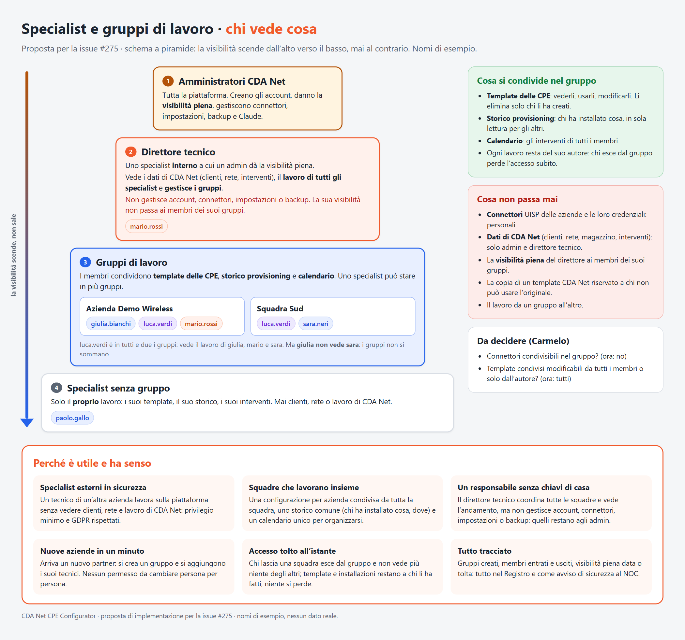
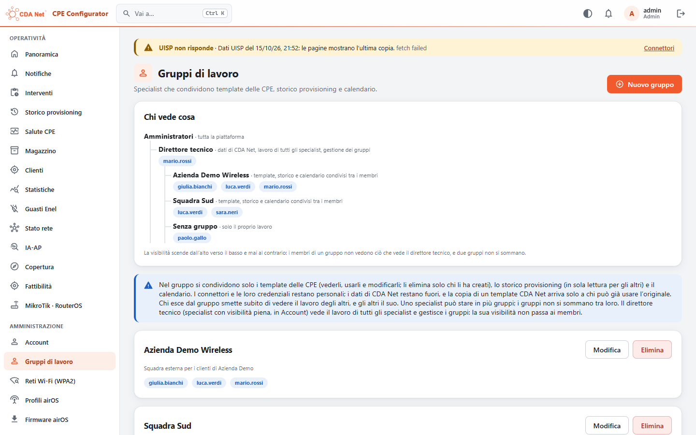

# Specialist, gruppi di lavoro e direttore tecnico

Issue #275 (v1.36.3). Uno Specialist può essere una persona esterna a CDA Net, quindi di default vede solo il proprio lavoro. Più Specialist possono lavorare insieme in un **gruppo di lavoro**. Un admin può nominare uno Specialist interno **direttore tecnico** dandogli la visibilità piena.

## Il lavoro dello Specialist

Lo Specialist è un ruolo accanto ad amministratore e installatore, per chi lavora in autonomia per altre aziende, con CPE che non sono di CDA Net (v1.36.0). Ha una sezione sua, separata dal lavoro di CDA Net:
- **Console**: Storico Specialist (separato da storico, statistiche, NOC, magazzino e Salute CPE, con CSV), I miei template e I miei connettori (l'UISP di ogni azienda, cifrato).
- **App**: l'area Specialist al posto di Installa.

Il flusso **Nuova CPE** nell'app:
1. **Prepara la configurazione** (basta Internet, senza collegarsi alla CPE): si sceglie un proprio template (nell'elenco il modello è davanti al nome) e si scrivono i valori per quella CPE: SSID e chiave Wi-Fi dell'AP dell'azienda se il template non li ha, PPPoE (non chiesto per un template in bridge o con il PPPoE spento), gateway se il template in bridge non lo fissa, VLAN e gli altri segnaposto propri. La WPA2, il PPPoE e le password scritte nel flusso non vengono mai salvati. La chiave UISP dell'azienda è facoltativa: senza, la CPE viene scritta con UISP spento e lo storico la segna «UISP spento». La configurazione vale 24 ore (Impostazioni server → Validità di una configurazione Specialist, da 1 a 72) e l'app mostra il tempo rimasto.
2. **Collegati alla CPE**: la discovery la trova qualunque sia l'IP; MAC, seriale, modello e firmware si leggono via SSH (credenziali di fabbrica o quelle attuali), senza etichette né magazzino. La scrittura è bloccata se il modello non è quello del template. Il firmware si aggiorna nel flusso o si tiene.
3. **Scrittura**, anche senza Internet; l'esito con MAC e seriale letti arriva al server anche più tardi. Una scrittura non riuscita si riprova, anche su un'altra CPE.
4. **Verifica** con le credenziali nuove, **collaudo** facoltativo (senza NOC) e **autorizzazione** nell'UISP dell'azienda, cercando la CPE solo dopo la scrittura.

Resta anche il modo di prima: chi è già sulla Wi-Fi della CPE la legge subito e prepara la configurazione per quella. Un template che usa il MAC o il seriale della CPE richiede la CPE letta prima. Dall'editor dei template, «Prepara una configurazione con questo template» porta a Nuova CPE con il template scelto.

I template dello Specialist (console e app, anche dalla CPE collegata) hanno il modulo come la CPE e un testo tutto suo, con VLAN e segnaposto propri; nella scheda Wireless SSID e chiave Wi-Fi, in Rete gateway e DNS del bridge (vedi [PROVISIONING.md](PROVISIONING.md#template-degli-specialist)).

Strumenti tecnici aperti a tutti gli Specialist, anche senza visibilità piena: discovery, strumenti di rete dal telefono, Trova l'AP, simulazione A → B nell'app (vedi [COPERTURA.md](COPERTURA.md#simulazione-a--b)).

## La piramide

La visibilità scende dall'alto verso il basso, mai al contrario.

| Livello | Chi | Cosa vede e cosa fa |
|---|---|---|
| 1 | **Amministratori** | Tutta la piattaforma. Creano gli account e danno la visibilità piena. Gestiscono connettori, impostazioni, backup e Claude. |
| 2 | **Direttore tecnico** (Specialist con visibilità piena) | I dati di CDA Net (clienti, rete, interventi, statistiche, Registro) come un admin, e le installazioni CDA Net come un installatore. Vede il lavoro di **tutti** gli Specialist e gestisce i gruppi di lavoro. **Non** gestisce account, connettori, impostazioni o backup. |
| 3 | **Gruppi di lavoro** | I membri condividono template delle CPE, storico provisioning e calendario. |
| 4 | **Specialist** | Il proprio lavoro, più quello dei membri dei suoi gruppi. Mai clienti, rete o lavoro di CDA Net, né le sue chiavi. |

## Cosa si condivide in un gruppo

- **Template delle CPE**: i membri li vedono e li usano per installare. Li modifica e li elimina solo chi li ha creati (`template_author_only` per gli altri), gli altri li aprono in sola lettura. I **segreti del template** (la community SNMP e, dalla v1.36.4, la chiave Wi-Fi dell'AP) restano del suo autore: solo lui li imposta o li toglie e solo le sue installazioni li usano. Gli altri membri, e anche il direttore, li scrivono nel flusso per ogni CPE: il server li chiede (`asked`) come per le chiavi Wi-Fi.
- **Storico provisioning**: le installazioni dei membri, in sola lettura. Collaudo e autorizzazione in UISP restano a chi ha installato, con i suoi connettori. Il CSV ha la colonna «Specialist».
- **Calendario**: gli interventi assegnati ai membri da quando sono nel gruppo, tranne quelli del direttore tecnico (possono essere interventi di CDA Net, con i suoi clienti). Restano fuori anche quelli che un membro aveva prima: da installatore, o da direttore (se gli si toglie la visibilità piena riparte da quel momento).

## Cosa non passa mai

- **I connettori** delle aziende (UISP) e le loro credenziali: restano personali.
- **I segreti dei template** degli altri membri (vedi sopra).
- **I dati di CDA Net**: solo gli admin e il direttore tecnico.
- **Le chiavi di CDA Net**: chiavi Wi-Fi delle reti e password delle CPE. Senza visibilità piena lo Specialist non fa lavoro di campo per CDA Net (`requireCdaWork`, `doesCdaWork`): niente installazioni CDA Net (`/api/provisioning/plan`, `/jobs`, `/result`, `/templates`, `/api/wireless-networks`, sostituzione), niente strumenti di campo sulle CPE di CDA Net (`/api/field/access`, `/relink`, `/cpe`, `/cpe/claim`, `/cpe/register`), nessun template CDA Net, nemmeno quelli per tutti. Lavora per le sue aziende nella sezione Specialist, con le credenziali scritte nel flusso.
- **La rete di CDA Net**: gli strumenti che lavorano dal server di CDA Net (interfacce, vicini ARP, ping, traceroute, DNS, NetBIOS, scansione, SNMP, porte, ONVIF, Hikvision, BGP) e RouterOS dalla console partono dalla sua rete, quindi senza visibilità piena no (`requireCdaWork`). Restano aperti il produttore dei MAC e il catalogo RouterOS; nell'app gli strumenti di rete lavorano dal telefono. Lo stesso per la copertura degli altri operatori, che usa l'abbonamento di CDA Net, e per le immagini satellitari a pagamento (Google, Mapbox, Esri, con le chiavi di CDA Net): la mappa 3D resta, con il terreno.
- **La rete di CDA Net attraverso i connettori**: l'UISP di un'azienda dev'essere su Internet. Il server rifiuta indirizzi privati, CGNAT, locali e riservati, anche quando ci arriva un nome DNS o un redirect, e un indirizzo con `?`, `#` o utente (`connector_target_not_public`, `connector_url_invalid`). Il test di un connettore riporta l'esito e lo stato HTTP, mai il testo della risposta.
- **La visibilità piena del direttore**: non passa ai membri dei suoi gruppi.
- **La copia di un template CDA Net**: resta a chi l'ha fatta; nel gruppo la vede solo chi può già usare l'originale. Così il direttore non passa al gruppo un template riservato. Le copie fatte prima della 1.36.3 il server le riconosce dalla nota (`Copia del template CDA Net «…»`) o dal Registro (`specialist.template_copy` scritto quando è nato il template), con la migrazione 48; se l'originale non c'è più, nel gruppo la copia la vede solo chi ha la visibilità piena. Una copia fatta prima, poi rinominata e con le note cambiate, non si può riconoscere: resta condivisa come un template qualsiasi.
- **Il lavoro da un gruppo all'altro**: i gruppi non si sommano. Se Luca è in due gruppi vede entrambi, ma Giulia, che sta solo nel primo, non vede Sara, che sta solo nel secondo.

## Regole

- Uno Specialist può far parte di più gruppi. Nei gruppi entrano solo gli Specialist.
- Creano e modificano i gruppi gli admin e il direttore tecnico. Uno Specialist non può aggiungersi da solo.
- Chi smette di essere Specialist esce dai suoi gruppi (avviso al NOC); se torna Specialist, un admin decide di nuovo.
- La visibilità piena la dà solo un admin, da Account. È spenta per tutti, compresi gli Specialist che esistono già. Quando viene data o tolta, le sessioni dello Specialist si chiudono e arriva un avviso di sicurezza al NOC.
- Ogni template e ogni installazione restano del loro autore. Chi esce da un gruppo smette **subito** di vedere il lavoro degli altri, e gli altri il suo.
- Nel Registro finiscono `work_group.create`, `work_group.update` (chi è entrato e chi è uscito) e `work_group.delete`, oltre a `user.update` per la visibilità piena. Gli stessi cambi (gruppo creato con i suoi membri, entrate, uscite, gruppo eliminato) arrivano come avviso di sicurezza al NOC.
- Nel Registro la creazione e la modifica di un template e ogni installazione riportano il gruppo («gruppo Squadra Sud») e, se il template è di un altro membro, il suo autore («template di spec.b»). Mai un segreto.

## Strumenti tecnici e dati di altri

Gli strumenti che non mostrano dati di altri restano aperti a tutti gli Specialist: modulo dei template, segnaposto, mappe, terreno, firmware, diagrammi delle antenne, guida.

Tutto quello che mostra dati di CDA Net o di altri richiede la visibilità piena (`requireSeesAll` sul server):
- stato e Registro;
- template CDA Net;
- statistiche;
- interventi dell'ufficio;
- UISP;
- CRM;
- guasti Enel;
- Victron;
- magazzino;
- IA-AP;
- fattibilità;
- salute piattaforma;
- precisione della copertura;
- antenne degli AP di CDA Net (nomi, clienti, azimut) e importazione dei diagrammi;
- copertura degli altri operatori (MyWic, sull'abbonamento di CDA Net): gli installatori hanno la loro risposta, senza i nomi; gli Specialist senza visibilità piena niente.
- immagini satellitari (Google, Mapbox, Esri, con le chiavi di CDA Net): le tile solo con la visibilità piena, l'elenco dei livelli risponde vuoto; il terreno della mappa 3D resta.

Nei controlli puntuali dei dati, `isStaff(role)` diventa `seesAll(user)`.

## Decisioni (Carmelo, 17/10/2026)

- **Connettori**: non si condividono nel gruppo.
- **Template condivisi**: li modifica solo chi li ha creati (Carmelo, 18/10/2026; `GROUP_EDITS_TEMPLATES = false` in `server/src/services/specialist.ts`). Se tutti i membri potessero cambiare il testo, potrebbero far finire i segreti dell'autore dove vogliono.
- **Segreti di un template usato da un altro membro**: li scrive chi installa, mai quelli dell'autore.

## App Android

- La sessione ha `fullView`: `seesAll` per le viste del NOC (agenda di squadra in Oggi, Salute CPE, guasti, rete, copertura), `doesCdaWork` per il lavoro di campo di CDA Net.
- Senza visibilità piena le schermate di installazione e degli strumenti sulle CPE di CDA Net (Installazioni, Installazione CPE, CPE collegata, Puntamento, Diagnosi, Collaudo) mostrano che servono le chiavi di CDA Net e portano alla sezione Specialist; Oggi, scorciatoie e Strumenti non le propongono, e il telefono non tiene le credenziali delle CPE di CDA Net.
- Il calendario riceve dal server solo i propri interventi e quelli del gruppo, senza `installers`, e mostra di chi è ogni intervento del gruppo.
- Template e storico Specialist mostrano l'autore del lavoro di un collega; template e installazioni dei colleghi sono in sola lettura; la copia di un template CDA Net c'è solo con la visibilità piena.

## In console

**Amministrazione → Gruppi di lavoro** mostra lo schema «Chi vede cosa», i gruppi e i loro membri. In **Account** c'è la casella «Visibilità piena · direttore tecnico». Nelle sue pagine (template e storico) lo Specialist vede i suoi gruppi e i colleghi; il template di un collega si apre in sola lettura e la copia di un template CDA Net c'è solo con la visibilità piena. Senza visibilità piena non ci sono MikroTik · RouterOS né la copertura degli altri operatori.

